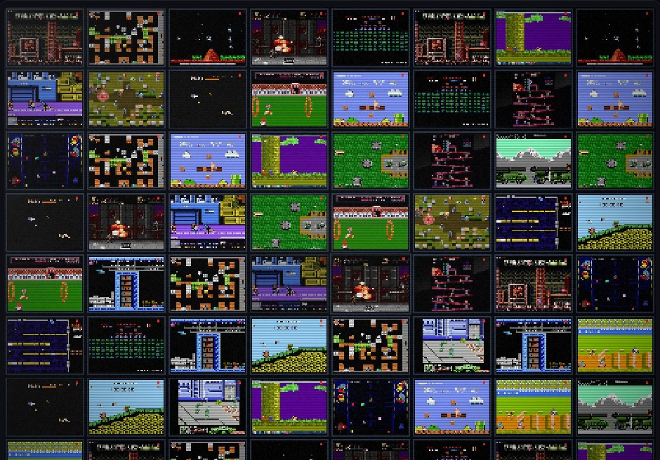

# dsh-subor-startup

小霸王 × DeepSeek Harness 的开机动画。

CRT 开机「其乐无穷」→ 贪吃蛇把 20 款经典 FC 游戏截图铺满屏幕 → 闪白渐黑，进入 DSH。



---

## 效果

| 时间 | 画面 |
| --- | --- |
| 0.0s | 显像管通电、白线展开 |
| 0.5s | 蓝屏、雪花、AV 字样（嵌入 DSH 时电视铺满全屏，无外壳） |
| 1.1s | 吉祥物、「深度」「求索」、「小霸王」逐字落下 |
| 2.3s | `DeepSeek Harness` 打字机 |
| 3.1s | 人声「啊哈，DeepSeek 其乐无穷啊」 |
| 4.4 ~ 5.7s | 「其乐无穷」逐字盖章 |
| 7.5s | 雪花转场 |
| 6.95 ~ 8.9 | 12×9 小游戏窗从左上角开始，像贪吃蛇一样向右、向下、向左、向上，一圈圈向内铺满全屏（1.9 秒） |
| 9.4 | 闪白 → 渐黑 |
| 10.1s | 移除遮罩，露出 DSH |

整段约 10 秒，跑马灯阶段按任意键可跳过。

## 特性

- **零配置**：装完即用，没有设置页，不写 profile 配置
- **全屏 iframe 隔离**：启动画面有自己的 CSS/Canvas，不会污染 DSH 的样式
- **自动播放**：打开 DSH 就播，不用点「开始」
- **可跳过**：跑马灯阶段按任意键，或等它自己结束
- **20 款经典游戏**：魂斗罗、超级玛丽、坦克大战、冒险岛、赤色要塞、绿色兵团、沙罗曼蛇、双截龙、忍者龙剑传、影子传说、马戏团、吃豆人、小蜜蜂、俄罗斯方块、炸弹人、越野摩托、打砖块、网球、超时空要塞、忍者神龟
- **像素级还原**：512×384 逻辑分辨率、Ark Pixel 像素字、CRT 扫描线/暗角/雪花/关机
- **失败兜底**：素材加载失败会自动回退到内置重绘场景；30 秒后无论如何都会放行，不会锁死黑屏

## 安装

插件市场（发布后）：

> DSH → 设置 → 插件市场 → 搜索 `dsh-subor-startup` → 安装 → 重启 DSH

本地开发：

```bash
dsh plugin --profile desktop add link:/Users/bravel/Documents/deepseek-harness/default-workspace/dsh-subor-startup
# 重启 DSH
```

安装后如果同时启用了别的启动画面插件（例如 `dsh-startup-screen`），**两层会叠在一起**，请只保留一个。

## 跳过与声音

- 跑马灯开始后（约 7 秒），按**任意键**跳过
- 浏览器要求先有一次用户交互才允许出声；没有交互时画面照常播，声音可能是静音
- 点一下页面可以解锁声音（不会触发跳过）

## 兼容性

- DSH Web profile：✓
- DeepSeek Harness Desktop（有 `webServer` 的形态）：✓
- Electron 纯 `file://` + IPC 下发前端（没有 `webServer`）的形态：暂不支持，Host 半侧会跳过注入

## 素材

- 代码：**PolyForm Noncommercial License 1.0.0**——个人、学习、研究、非商业项目免费；**商业用途需要单独授权**
- 字体：[Ark Pixel Font](https://github.com/TakWolf/ark-pixel-font)，SIL OFL 1.1，见 `public/assets/fonts/OFL.txt`
- 人声：基于原机录音片段拼接的「DeepSeek」版本，仅个人怀旧使用

## 文件结构

```
dsh-subor-startup/
├── package.json
├── cordis.patch.yml
├── lib/
│   └── index.js          # Host 半侧：静态路由 + iframe 注入
├── public/
│   ├── splash.html
│   ├── preview.jpg
│   ├── assets/
│   │   ├── style.css
│   │   ├── js/boot.js
│   │   ├── fonts/font.css
│   │   └── games/*.jpg    # 20 张游戏截图（可删，自动回退）
│   └── audio/
│       └── deepseek-short-deep.wav
├── README.md
└── LICENSE
```

## 开发预览

不装插件也能看：

```bash
cd public
python3 -m http.server 8000
# 打开 http://localhost:8000/splash.html
```

`?embed=1` 是插件里 iframe 用的模式，结束后会给父页面发 `dsh-subor:done`；普通模式结束后会跳 `?next=` 指定的地址（默认 `http://127.0.0.1:62309`）。

## License

代码采用 [PolyForm Noncommercial License 1.0.0](https://polyformproject.org/licenses/noncommercial/1.0.0)：

- 个人使用、学习、研究、爱好项目、非商业组织使用：免费
- **商业用途需要单独授权**：在 [Issues](https://github.com/hongshunanhai/dsh-subor-startup/issues) 里说明公司、产品和用途，可以单独谈商业许可

这不是 OSI 意义上的开源许可证，是 source-available（源码可见、非商业免费）。字体（OFL）的说明见 `LICENSE`。
